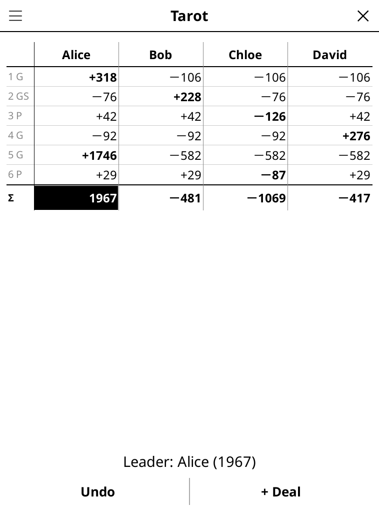

# scoresheet.koplugin

**Score sheets** (FR « Feuilles de score ») for [KOReader](https://github.com/koreader/koreader) — keep the score of the card and board games you play around a real table, with the e-reader as the score pad.

## Screenshot



## Sheets

- **Tarot** — French rules (FFT), 3, 4 or 5 players (with 5, the taker calls a partner). Per deal: taker, contract (Petite, Garde, Garde sans, Garde contre), oudlers, card points, petit au bout, poignée, chelem. Zero-sum dispatch to the defenders.
- **Belote / Coinche** — two teams, target 1000/1500/2000 or your own. Belote: taking team, card points, belote-rebelote, capot, « dedans », « litige ». Coinche: bid 80–160 or capot, coinche ×2 / surcoinche ×4.
- **Word tile game** (« Jeu de lettres ») — 2 to 4 players, one line per turn, +50 when all seven tiles are placed, end-of-game leftover tiles deducted (and given to the player who went out).
- **Rummy** (« Rami ») — penalty points per round; a player whose total goes over the limit (100 by default, editable) is out; the last one in wins.
- **Free sheet** — any other game: 1 to 8 players, points per round (negative allowed), highest or lowest wins, optional target score.

## Features

- Big on-screen number pad for every score (with ½ for Tarot half points, ± on the free sheet).
- Live preview of the round before it is validated ("Made by 5 · Bob +240 · each defender −80").
- One sheet per game in progress, kept when the screen is closed: Tarot, Belote and Rummy can each have their own game waiting.
- Names typed once and remembered (tap a name at the top of the sheet to rename it); New game keeps them.
- Round-by-round table with bold takers, totals below, the leader's total inverted; tap a line for the details of that round; swipe to scroll a long game.
- Undo the last round.
- Rules of each sheet in English and French (☰ → Rules).

## Rule choices

**Tarot** follows the FFT rules ("donnes libres"), checked against the five worked examples of the official rules:

- value = (25 + points over or under) × contract (Petite 1, Garde 2, Garde sans 4, Garde contre 6), + petit au bout 10 × contract to the side that took it, + poignée 20/30/40 (not multiplied) to the side that **wins** the deal, + chelem (+400 announced and made, +200 made unannounced, −200 announced and failed, +200 to each defender for a defence chelem);
- points needed 56/51/41/36 for 0/1/2/3 oudlers; a half point goes to the winning side (40½ for 41 → 40, 41½ → 42);
- 4 players: taker ×3; 3 players: taker ×2; 5 players: taker ×2 and called partner ×1, taker alone (called himself or king in the dog) ×4; each defender −1×.
- Only one poignée per deal can be entered (both sides showing one is rare; add the second one's value by hand on the free sheet if needed).

**Belote** (classic): 162 points per hand (10 de der included); the taking team must make **more** than the other (belote-rebelote counted for its holder); otherwise « dedans », the defence takes 162; a 81–81 tie is a « litige »: the defence scores its 81, the takers' 81 are carried to the winner of the next hand; capot 252; belote-rebelote +20 always kept by its holder; no rounding.

**Coinche** (« points faits + contrat »): the takers must reach their bid (belote-rebelote counts) and make at least 82; made: bid + points made (defence: its points); made and coinched: bid × 2 (or × 4) + 160, defence 0; failed: defence 160 + bid (× 2 / × 4); capot counts 250; a capot bid needs every trick; no rounding.

**Rummy**: out when the total goes *over* the limit (101 with the default 100).

## Development

`tarot.lua`, `belote.lua` and `sheet.lua` hold the scoring and the sheet bookkeeping (pure Lua, no UI), `numentry.lua` the keypad entry, `numpad.lua` the keypad widget, `score_table.lua` the table, `screen.lua` the screens, `rules.lua` the rules texts. Player names go through game-common's `party.lua`.

```
busted test_scoring_spec.lua
```

## License

GPL-3.0
